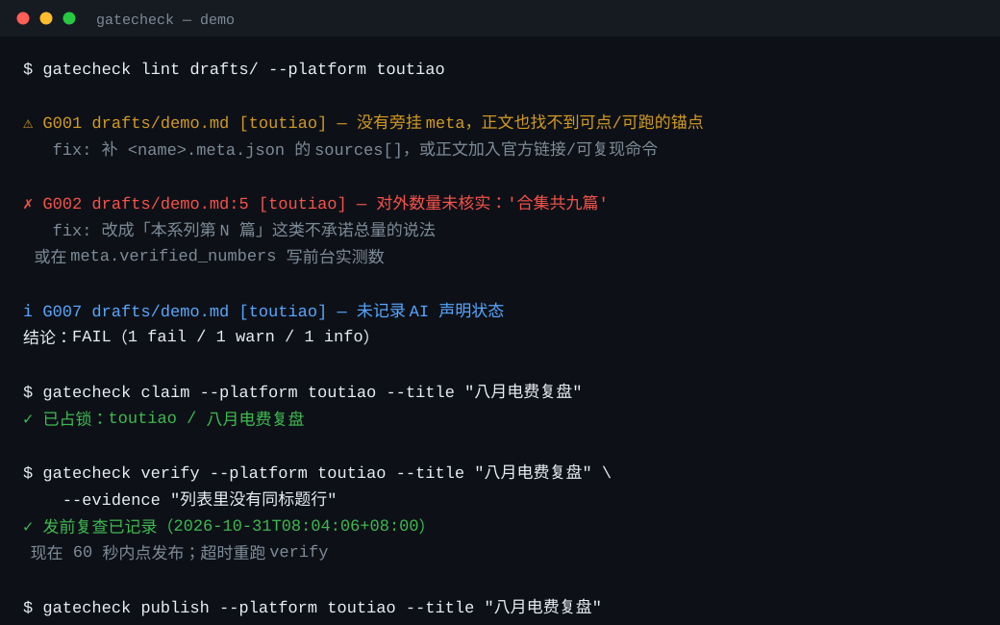

# gatecheck

**发布前的本地门禁：禁词机检 + 五态发布锁 + 真实时钟台账。**

不登录平台、不代发、不上传内容。Python 3.9+，**零第三方依赖**（只用标准库）。

> 它不是写作助手，也不判断内容好不好。它只拦三类"发出去就收不回来"的错误：同一个东西发两遍、说了一个数不出来、拿恒真的判据骗自己。



---

## 一、它为什么存在

以下四个场景都是真实踩过的坑，代价都是不可逆的（删稿、下架、指标失真）。账号与作品信息已隐去。

**1. 重复发布。** 两个窗口各自判断"这篇还没发"，10 分钟内同一篇发了两遍，只能删掉其中一篇。两个 Agent 并发时更容易发生。

→ 五态发布锁：`claim` 占标题、`verify` 记发前复查、`publish` 机械强制 60 秒窗口、`confirm` 要求列表出现同标题行。同一标题 24 小时内不能再 claim，冲突时打印上次证据。

**2. 把内部序号当对外数量。** 草稿写到第 9 篇，正文顺手写"合集共九篇"，前台实际只有 2 条。

→ G002 只抓"合集/系列/专栏 + 篇数"这种对外承诺；没有 `verified_numbers` 就 fail，建议改成"本系列第 N 篇"。

**3. 判据恒真。** 用"累计 ≥ 10"判断赛道切换是否有效——切换的那一秒就已经满足，指标彻底失去鉴别力。另一种变体是把平台的激励任务奖励当成内容分成。

→ G008 审判据文件：累计口径、缺失观察窗口、缺失数据源、把激励算成平台收入，全部 fail。

**4. 在商品页写"我不做什么"。** 描述里为了声明合规写了"不做真人复活""不换脸""不代登录"，机审不理解否定语义，只匹配到那些词，商品被按违禁品删除。

→ G009 命中禁词即 fail，**否定句同样命中**，并在消息里注明原因。这是它和多数"敏感词检查"最不一样的地方。

---

## 二、安装

```bash
git clone <this-repo> gatecheck
cd gatecheck
python3 -m gatecheck --self-test   # 8 项冒烟检查，约 0.1 秒
```

零依赖，不需要安装任何第三方包。想装成命令：

```bash
python3 -m pip install -e .   # 会拉取 setuptools>=61 构建后端；离线环境请直接用 python3 -m gatecheck
gatecheck --version
```

要求 Python ≥ 3.9。macOS 自带的 `/usr/bin/python3`（3.9.6）可直接运行。

---

## 三、60 秒上手

```bash
gatecheck init                                  # 在当前目录生成 gatecheck.json
gatecheck lint drafts/ --platform toutiao       # 检查目录下所有 .md/.txt
gatecheck metrics check examples/milestones.json
gatecheck doctor                                # 锁、台账、发布记录、判据体检
```

`examples/milestones.json` 第二条是**故意写错的反例**，所以这条命令会 exit 1——它演示的正是 G008 抓恒真判据。

草稿约定：正文与 `<同名>.meta.json` 放在一起。meta 至少包含：

```json
{
  "title": "标题",
  "sources": [
    {"claim": "这句话的事实", "url": "https://…", "fetched_at": "2026-10-25T21:38:00+08:00"}
  ],
  "ai_declaration": true,
  "answers_in_150": true
}
```

没有 meta 也能跑：G001 会降为 warn/info（正文里有链接、反引号命令或 `ops/` 路径算弱锚点）。

**运营笔记型草稿**（正文包在 ``` 里，外面是复盘、改动表）用 `--fenced` 只检查代码块，否则笔记里"举例说明某个禁词"会被自己拦下来：

```bash
gatecheck lint drafts/xhs-note.md --platform xhs --fenced
```

---

## 四、命令与退出码

| 命令 | 作用 | 退出码 |
|---|---|---|
| `lint PATHS... --platform a,b` | 检查草稿；目录会递归 | 0 通过 / 1 有 fail / 2 用法或 IO |
| `claim --platform --title [--owner] [--ttl]` | 占标题，默认 TTL 2 小时 | 0 / 3 冲突 |
| `verify --platform --title --evidence` | 记录发前复查 | 0 / 3 |
| `publish --platform --title` | 点发布时执行，强制 60 秒窗口 | 0 / 3 超时 |
| `confirm --platform --title --list-row` | 列表出现同标题行后确认 | 0 / 3 |
| `release --platform --title --reason` | 释放锁，必须写原因 | 0 / 3 |
| `status --platform --title` | 查看锁状态 | 0 |
| `ledger add --owner --action --criteria` | 追加一条真实时钟记录 | 0 / 2 |
| `ledger tail [--n 20]` | 最近记录 | 0 |
| `metrics check FILE` | G008 判据审计 | 0 / 1 / 2 |
| `doctor` | 全量体检 | 0 / 1 / 2 |
| `init` | 生成配置，不覆盖已有文件 | 0 / 2 |

退出码统一：`0` 通过；`1` 有 fail；`2` 用法/配置/IO 错误；`3` 锁冲突或时序违规。

`--json` 输出固定结构，方便接 CI 或别的脚本：

```json
{
  "tool": "gatecheck", "version": "0.1.0", "command": "lint",
  "ok": false, "exit": 1, "now": "2026-10-25T21:40:00+08:00",
  "counts": {"fail": 1, "warn": 2, "info": 0, "skip": 0},
  "items": [{"rule": "G009", "severity": "fail", "path": "…", "line": 14,
             "excerpt": "…", "message": "…", "fix": "…", "data": {"platform": "xhs"}}]
}
```

---

## 五、五态锁

```
claimed --verify--> verified --publish(≤60s)--> published --confirm(≤15min)--> confirmed
   |          |              |                    |
   +----------+--------------+--------------------+--> released（必须写 reason）
```

为什么把窗口拆成两段：

- **60 秒放在 `publish` 上**：`verify` 是"我刚看过列表，没有同标题"，这个判断只在点发布前的一分钟内有效。超时就重新 `verify`。
- **15 分钟放在 `confirm` 上**：发布后平台列表常常要几十秒才出现新行，把 60 秒卡在确认上会误伤正常流程。

```bash
gatecheck claim   --platform toutiao --title "标题"
gatecheck verify  --platform toutiao --title "标题" --evidence "列表里没有同标题行"
gatecheck publish --platform toutiao --title "标题"
# 等管理后台出现同标题行，再：
gatecheck confirm --platform toutiao --title "标题" --list-row "标题 10-25 21:33 审核中"
```

几条硬规则：

- `confirm` 会校验列表行里确实包含标题（归一化后比较），防止"我以为它出现了"。
- 已发布但 15 分钟内没确认，`doctor` 报 `已发布未确认`，提示你查列表，**绝不自动释放**——那篇很可能已经上线了。
- 同一平台同一标题，发布/确认后 24 小时内再 `claim` 直接 exit 3，并打印上次的证据。
- 两个人同时 claim，只有一个成功：锁文件旁挂 `<key>.guard`，`flock(LOCK_EX|LOCK_NB)`；写入走临时文件 + `os.replace`。
- 实在发不出去就 `release --reason "…"`，留下原因，别让锁僵在那儿。

锁目录必须在本地同一卷上（`flock` 与原子替换的可靠前提）。

---

## 六、规则

`lint` 跑 G001–G007、G009；G008 在 `metrics check` / `doctor` 里跑。

| 规则 | 抓什么 | 级别 |
|---|---|---|
| G001 事实锚点 | meta 里没有一条 `url`/`ref`；有锚点但缺 `fetched_at` | fail / warn；无 meta 时 skip 降级 |
| G002 数字出处 | 「合集/系列/专栏 … N 篇」这类对外数量，没有 `verified_numbers` | fail（口径很窄，不误伤算术） |
| G003 标题兑现 | 疑问式标题，正文没有可判定的答案 | warn |
| G004 空喊引流 | 「关注我 / 评论区扣1 / 求赞」；裸「点赞/转发/收藏」只在同句有请求对象时提醒 | fail / warn |
| G005 跨平台同文 | 归一化后完全相同 → fail；相似度 ≥ `warn_ratio`（默认 0.86）→ warn | fail / warn |
| G006 模板味 | 赋能/闭环/抓手/底层逻辑… 命中 ≥5 次，或长稿里密度 ≥3/千字 | warn |
| G007 AI 声明 | 列出该平台发布页要勾的项，只提示，不代勾 | info / warn（永不影响退出码） |
| G008 判据可鉴别 | 累计口径、缺观察窗口、缺数据源、激励奖励当分成 | fail |
| G009 平台禁词 | 内置词表 + 配置 `extra_banned`；**否定句同样命中**；超长/首行过长/站外链接 | fail / warn |

关于"误报"的取舍：宁可漏报，不可每天误报——一个天天误报的门禁，用三天就会被关掉。所以 G003、G006 只 warn；G002 的匹配范围刻意写窄；G005 会跳过"运营笔记全文包含正文"和"CTA 摘录"这类同稿文件。

---

## 七、配置

`gatecheck.json` 从当前目录向上查找，也可用 `--config` 或 `GATECHECK_CONFIG` 指定。`gatecheck init` 生成全量默认值。

| 键 | 默认 | 说明 |
|---|---|---|
| `state_dir` | `.gatecheck` | 锁文件目录（建议加进 `.gitignore`） |
| `ledger_dir` | `ledger` | `clock-YYYY-MM-DD.jsonl` |
| `published_dir` | `published` | 发布记录 `YYYY-MM-DD.md`，只追加 |
| `corpus.roots` | `["drafts"]` | G005 的语料目录 |
| `corpus.window_days` | `14` | 只比对最近 N 天的稿 |
| `corpus.max_docs` | `200` | 语料上限，避免大仓库变慢 |
| `corpus.exclude` | `[]` | 按文件名通配排除，例如 `["*-cta.*"]` |
| `duplicate.warn_ratio` | `0.86` | 相似度提醒阈值 |
| `publish_lock.claim_ttl` | `7200` | 占锁秒数（够传图与封面） |
| `publish_lock.verify_to_publish` | `60` | verify → publish 窗口 |
| `publish_lock.publish_to_confirm` | `900` | publish → confirm 窗口 |
| `publish_lock.dedupe_hours` | `24` | 同标题去重窗口 |
| `platforms.<name>.title_max` | 按平台 | 有 meta 标题时校验标题长度 |
| `platforms.<name>.ai_declaration` | `[]` | G007 打印的勾选清单 |
| `platforms.<name>.extra_banned` | `[]` | 项目自定义禁词 |
| `milestones` | `[]` | 判据列表，`doctor` 会一起审 |

内置平台名：`toutiao` / `xhs` / `csdn` / `xianyu` / `kuaishou` / `baijiahao` / `douyin` / `wechat`。未在配置里出现的平台名会直接报错（exit 2），不会静默放行。

---

## 八、台账与发布记录

台账是 append-only 的 JSONL，时间取本机真实时钟（`ledger add` 拒绝 `--now`，防止补写成历史）：

```json
{"v":1,"ts":"2026-10-25T21:40:00+08:00","kind":"note","owner":"me@host:1234",
 "platform":"toutiao","slot":"night","action":"写稿","criteria":"有实测数据",
 "evidence":"0.88 度","missing":["曝光"]}
```

`missing` 用来记录"这次没采到什么"，`doctor` 会对超过 24 小时仍未补齐的条目提醒。

发布记录只在 `published/YYYY-MM-DD.md` 末尾追加一个小节，已存在同标题小节时不重复写，**永不重写既有表格**。

---

## 九、边界

- 不登录、不抓取需要登录的页面、不代发、不上传。它只做事前自检。
- G009 是机审的**近似**，词表是内置副本，平台规则变化时需同步更新；它不承诺"保证过审"，也不能绕过平台审核。
- G005 只在本地语料里比对，比不了另一个平台的线上历史。
- `flock` 只在本地卷可靠；不要在 NFS/iCloud 同步目录里放锁。
- 需要 Python 3.9+；未使用 `match`、`tomllib` 等 3.10+ 特性。

---

## 十、开发

```bash
python3 -m unittest discover -s tests -v
python3 -m gatecheck --self-test
```

测试不联网，全部在临时目录里跑，包含一个"两个真实进程同时 claim"的并发用例。

## License

Apache-2.0，见 [LICENSE](LICENSE)。
